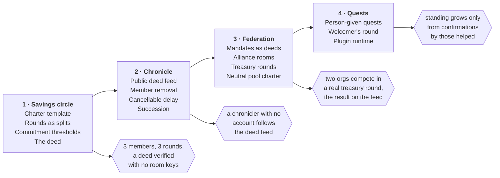

# Muster for the Logos World: A Plan

2026-11-06 · Corey Petty · for Jarrad Hope · epic exo-267 · the full mapping: [logos-world.md](logos-world.md)

Muster can be the rails for the orgs your world will form: a Muster room is the org, its log is the
org's ledger, and a deed its members choose to publish is Logos's killmail. The plan builds that in
four phases, starting with a savings circle that runs end to end and ends in a published deed.

## What exists today

Much of what the world material asks of orgs and witnesses is already enforced in Muster's code, and
none of it is a loose analogy. Each row below is a guarantee with tests behind it.

| What the world needs | What Muster already does |
| --- | --- |
| An org ledger every member can read | The room's state is rebuilt from its log; every entry is authored and hash-linked, and members read the history, provenance and room map from it |
| A killmail: automatic, attributed, factual | The signature-audit file and log proof are generated from the log, name who signed, and say what happened, never what it meant |
| Witness by default, publish by consent | The room is the boundary; provenance is readable only inside it; sharing a proof or receipt outside is the member's own act |
| Secure process, never intent | Muster proves what was agreed and where its inputs came from; it never judges whether the act was wise |
| Destructive acts need several keys | Safe, Bitcoin multisig, LEZ multisig and FROST accounts; a decline is final |
| Deeds, not scores | Muster grades only your own holdings and never computes a score or rank about another member |
| A city gate at every border | Every proposal card answers what it does, what it needs, what it touches and who will see what |
| A shared load nobody can finish alone | Any k-of-n proposal |
| An honest trade with a real counterparty | A split's payment counts only when the payee's own read of the chain confirms it |

What Muster lacks is everything past the room's wall: a record that can leave the room by consent, a
feed for it to land on, and the machinery (charter, roles, succession, federation) that turns a room
into an org. The phases below build those.

## The plan at a glance

Each phase ends on a demonstrated test (the hexagons) rather than a date. The deed built in Phase 1
is what every later phase rests on: the feed carries deeds, mandates are deeds, and quests end in one.

## Phase 1: the savings circle

Phase 1 ends when a circle of three runs three rounds and its members publish a deed that a fourth
person verifies without any room keys. It is filed as epic exo-267, in five issues.

| Piece | What it is | Builds on |
| --- | --- | --- |
| Charter (exo-267.1) | A founding entry in the room's log: name, purpose, role slots named by the members, a table of which rule governs which action, and the rule for changing rules. The circle is a charter template, never a type | Proposals that change the room's own policy |
| Rounds (exo-267.3) | One ROSCA round is a split: that round's recipient is owed, every other member pays their own share, and the recipient's own read of the chain confirms each payment | The split, already running on Ethereum, Bitcoin, LEZ and Monero |
| Thresholds (exo-267.2) | A capability unlocks once the log shows enough: rounds completed, tenure, funds pooled. It never checks what kind of room it is | The readiness checks every proposal card already shows |
| The deed (exo-267.4) | A record of one event that names a member only with that member's agreement and that anyone can verify outside the room | The split receipt and the signature-audit file |
| Exit test (exo-267.5) | The whole circle, first in-process, then through the real client | — |

The deed is the piece the rest of the plan depends on, so it gets a written spec before any code.
Three questions decide its design:

1. How does a deed prove it came from a real room without revealing the room?
2. Which public name does a member sign under? Their room key would link every room they are in, and
   a fresh key per deed would bind nothing.
3. Can a published deed be withdrawn? Probably not, because irreversibility is what makes stakes real.

For the second question, the likely answer is personas: one or more public names the member chooses,
each linked to their room identity only inside the room where the deed was made. The member then
decides which deeds accumulate under which name.

## Phase 2: the chronicle and org machinery

Phase 2 gives deeds somewhere public to land and gives a room the rest of System 13's machinery. It
ends when a chronicler with no Muster account can follow a feed of deeds and build a board from it.

- **The chronicle feed.** An open feed of published deeds, on a public delivery topic, Logos Storage,
  or both, since Muster runs no server. Muster publishes and verifies. The killboards, the press and
  the leaderboards you want as a generic component are what others build on the feed. One limit to
  state honestly: the store node sees who publishes unless the send goes over the mixnet.
- **Removing a member.** The encryption layer can already remove a member, so they cannot read what
  follows, but no method exposes it yet. Expulsion is an org act, so it runs under the charter's rule.
- **A delay that any keyholder can cancel.** Today a proposal that reaches its threshold can be
  settled at once. A delay with a visible pending notice prices a heist without preventing it.
- **Succession.** An inactivity rule in the charter: if no officer acts for N days, a named fallback
  group may rotate the signers. For a Safe, rotating owners is already an ordinary transaction.

## Phase 3: federation and treasury rounds

Phase 3 lets rooms act on each other without reading each other's logs, which is what a placed
asteroid needs. It ends when two orgs compete in a real treasury round and the outcome lands on the
chronicle feed.

- **Mandates.** An alliance room's members are delegates of their own rooms. Each delegate acts under
  a mandate, which is a deed their room's threshold signed. The deed from Phase 1 is therefore also
  the credential that passes between rooms.
- **Treasury rounds.** A pool room holds the funds in a Safe or FROST account, takes proposals from
  other rooms presented under their mandates, and settles the winners under its charter. Every
  contest lands in the pool's log, and its result can become a deed.
- **Operator neutrality.** The rule that the foundation never picks a winner becomes part of the
  pool's charter, which anyone in it can read.

This phase needs a real pool with real funds behind it, which is one of the decisions below.

## Phase 4: quests

A person-given quest is a proposal: the giver proposes the task, the taker accepts it, a named
confirmer marks it done, and a deed follows. Phase 4 ends when a welcomer's standing grows only from
confirmations by the people they helped.

- **The welcomer's round.** Standing is recorded only when the helped person confirms it, never by
  headcount. This is the same rule a split already uses, where the payee's own read confirms a payment.
- **The first session.** Muster's first session already has the corridor's three acts: a solo act
  (your identity and a room on your own node), an honest trade (a first split or payment with a real
  counterparty) and a shared load (a first k-of-n approval).
- **Game logic lives in plugins.** Quests with rules of their own, lotteries and in-world mechanics
  run as plugins that suggest actions and never sign. The plugin runtime is not built yet, so it
  gates this phase.

## The law partition

Muster can hand the constitution its column of coded-impossible acts now, because each one is an
invariant with tests. Everything else stays legal and lands in the log with names attached.

| Coded-impossible in Muster | Legal, and auditable |
| --- | --- |
| Forging another member's approval | A keyholder doing something the room approved and later regrets |
| Replaying a signature in another chain, account, slot, or after it expires | Joining a room and earning admission honestly, then betraying it |
| Signing bytes that differ from the proposal everyone reviewed | Collusion among enough signers to meet a threshold |
| Signing anything whose inputs cannot be traced to where they came from | Proposing a payment nobody needed |
| A later member reading what the room said before they joined | — |
| A plugin signing, holding keys or reaching the network | — |
| An outsider learning who is in a room from the store node | — |

What an act meant is not Muster's to decide. The audit file can settle a dispute about evidence; it
never says who was right.

## Where Muster stops

Muster supplies the world's orgs, ledger and witnesses; Basecamp is the world itself.

- **Not a scorekeeper.** Leaderboards and rankings are views over the chronicle, built by
  chroniclers. The core never computes a verdict about a member.
- **Not a presence oracle.** From outside a room, nobody can tell who is in it, by design. Inside,
  the roster is visible.
- **Not anonymous inside a room.** Every member who approves, declines or shares is named to the
  rest of the room. Anonymous membership was retired, and bringing it back would need its own
  decision record.
- **Not the judge.** See the law partition above.

## Decisions we need from you

The first two shape Phase 1's design; the rest can wait until their phase.

- [ ] Which fields of a circle's deed are publishable by default, and which only if each member opts in?
- [ ] Is the charter an object only Muster rooms know about, or a Basecamp-level org that Muster rooms implement?
- [ ] Is a public delivery topic an acceptable home for the chronicle feed, given that the store node
      sees who publishes unless the mixnet is on?
- [ ] Is there a real pool (the foundation's, or a zone's) that could run the first treasury round in Phase 3?
- [ ] Should the coded-impossible column above go into the constitution as written, ahead of the first heist?
