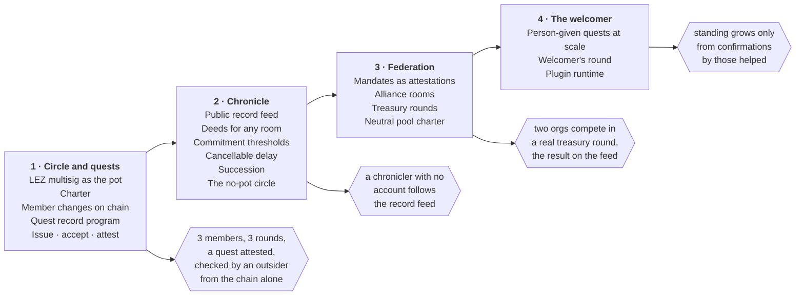

# Muster for the Logos World: A Plan

2026-11-06, revised 2026-11-09 · Corey Petty · for Jarrad Hope · epic exo-267 · the full mapping: [logos-world.md](logos-world.md)

Muster can be the rails for the orgs your world will form. A Muster room is the org, and its log is
the org's ledger. A LEZ multisig gives the org a shared pot and a public name, and its votes on chain
are a record anyone can check. The plan builds that in four phases. It starts with what you proposed:
a savings circle on the LEZ multisig that issues quests and attests to them through the same multisig.

**What changed in this revision.** The first draft paid each round as a split between members, so
nobody held a pot, and it left quests for the last phase. Your note moves the circle onto the LEZ
multisig and brings quests into Phase 1, and that is the better order. The multisig's executed
proposals are already public, attributed and permanent, so a quest attested through it needs no
separate deed format to be verifiable outside the room. The split-based circle stays as a variant
for groups that want no shared pot (Phase 2).

## What exists today

Much of what the world material asks of orgs and witnesses is already enforced in Muster's code, and
none of it is a loose analogy. Each row below is a guarantee with tests behind it.

| What the world needs | What Muster already does |
| --- | --- |
| An org ledger every member can read | The room's state is rebuilt from its log; every entry is authored and hash-linked, and members read the history, provenance and room map from it |
| A shared pot only the group can spend | A LEZ multisig's vault: anyone pays in, and it pays out only when enough members vote, each with their own transaction, counted by the chain |
| Membership the chain enforces | The LEZ multisig program adds and removes members and changes its threshold by proposal, and counts only current members' votes |
| A killmail: automatic, attributed, factual | The signature-audit file and log proof are generated from the log, name who signed, and say what happened, never what it meant. On LEZ the multisig's proposals and votes are themselves a public record |
| Witness by default, publish by consent | The room is the boundary; provenance is readable only inside it; sharing a proof or receipt outside is the member's own act |
| Secure process, never intent | Muster proves what was agreed and where its inputs came from; it never judges whether the act was wise. Before a member votes, Muster re-reads the proposal on chain and refuses if it differs from what the room reviewed |
| Destructive acts need several keys | Safe, Bitcoin multisig, LEZ multisig and FROST accounts; a decline is final |
| Deeds, not scores | Muster grades only your own holdings and never computes a score or rank about another member |
| A city gate at every border | Every proposal card answers what it does, what it needs, what it touches and who will see what |
| An honest trade with a real counterparty | A split's payment counts only when the payee's own read of the chain confirms it |

What Muster lacks is everything past the room's wall: a record of a quest that the chain itself
keeps, a feed for records to land on, and the machinery (charter, roles, succession, federation) that
turns a room into an org. The phases below build those.

## The plan at a glance

Each phase ends on a demonstrated test (the hexagons) rather than a date. The attested quest built in
Phase 1 is what later phases rest on: the feed carries such records, a mandate is one circle
attesting to a delegate, and the welcomer's round is a quest whose confirmer is the person helped.

## Phase 1: the circle and its quests

Phase 1 ends when a circle of three runs three rounds from its pot, issues a quest, and attests to
it, and a fourth person with no Muster account and no room keys checks that attestation from the
chain alone. It is filed as epic exo-267.

### The circle

A circle is a room with a LEZ multisig whose members are the room's members, and whose threshold the
charter sets. The vault is the pot. Each round, every member pays their share into the vault from
their own account, and the round's payout is a proposal to transfer from the vault to that round's
recipient. The members vote, and the chain pays at the threshold. Muster already does most of this
on a local LEZ v0.3 zone: the room creates the multisig, proposes a transfer out of the vault, votes
after re-reading the proposal from the chain, and settles.

A shared pot also allows more than a rotation. A savings group can keep the pot growing, lend from
it, and share it out at the end of a cycle, and each of those is a proposal like any other payout.

### Quests through the circle

A quest has four steps, and each one is a signed act by the person it concerns:

1. **Issue.** The circle proposes a quest: the task, the bounty, and who confirms it is done. When
   the members' votes reach the threshold, the multisig opens a quest record on chain. The record
   carries a hash of the terms, not the terms, so the task text stays in the room until its members
   choose to publish it, and anyone can then check it against the hash.
2. **Accept.** The taker accepts with their own transaction, under an account they choose. Nobody can
   be named as a quest's taker without signing it themselves.
3. **Confirm.** The named confirmer, which for a person-given quest is the person helped, signs that
   it is done. The circle's members cannot stand in for the confirmer.
4. **Attest.** The circle's members vote to close the quest and pay the bounty from the vault. The
   chain then holds a closed record: who issued it, who took it, who confirmed it, and the
   members' votes that closed it.

### The pieces

| Piece | What it is | Builds on |
| --- | --- | --- |
| Charter (exo-267.1) | A founding entry in the room's log: name, purpose, role slots named by the members, the circle's multisig account, the round schedule, the share and cadence, and the rule for changing rules. Membership and threshold are enforced by the chain; the schedule, share and roles by the room. The circle is a charter template, never a type | Proposals that change the room's own policy |
| Rounds from the pot (exo-267.3) | Members pay in; each round's payout is a vault transfer the members vote on. Before a member votes, Muster shows whether the payout matches the charter's schedule | The LEZ multisig's propose, vote and settle, built for v0.3 |
| Member changes (exo-267.6) | Adding or removing a member, and changing the threshold, as proposals from the room. Removing a member on chain also removes them from the room's encryption, so they stop reading it | The program's member changes; the room's encryption layer, which can already remove a member |
| Quest record program (exo-267.7) | A small LEZ program. A record is opened and closed only by its issuer's vault, accepted only by the taker's own signature, and marked confirmed only by the confirmer's | LEZ v0.3's program model, the one the multisig port uses |
| Quests in the room (exo-267.8) | The issue, accept, confirm and attest flow as room proposals and cards, with the terms kept in the room and committed by hash | The quest record program; the proposal card |
| The multisig on the testnet (exo-eb6.4.4.5) | The v0.3 multisig program offered upstream and deployed on the LEZ testnet, so a circle runs on a shared chain and not only a local zone | The port, built and tested on a local zone |
| Exit test (exo-267.5) | The whole circle, first on a local zone, then on the testnet through the real client | — |

### What a quest record answers about deeds

The first draft left three questions open about the deed. For a circle with a LEZ multisig, the
chain answers them:

1. **How does a record prove it came from a real group without revealing the group?** Its issuer is
   the multisig's vault, and the chain shows the threshold was met among that multisig's members. It
   reveals the multisig, not the room's messages or the people behind its accounts.
2. **Which public name does a member sign under?** A multisig needs every member's account to be
   fresh when it is created, so Muster gives a member a new LEZ account for each multisig they join,
   from a key that never leaves their keystore. That account is a public name scoped to one circle. A taker accepts under whichever account they choose, which is the persona idea from the
   first draft, enforced by a signature.
3. **Can a record be withdrawn?** No. The chain keeps it.

A deed for a room with no LEZ multisig, or one that combines several facts, still needs the
off-chain format from the first draft. It moves to Phase 2 (exo-267.4).

### What the chain shows

The LEZ multisig is public, so a circle's books are public by default. That inverts the room's
default, where everything stays inside, and it is the first decision below.

| Anyone can see | Only the room sees |
| --- | --- |
| The multisig's member accounts and its threshold | The room's messages |
| Every payment into the vault and every payout: amount and account | The quest's terms, until members publish them |
| Every vote, by account | Who the people behind the accounts are |
| Every quest record: issuer, taker, confirmer, bounty, status, the terms' hash | The charter's schedule and roles |

A member's account is fresh for that one circle, so it links to nothing else by itself. What can
link it is how it is funded: each member pays the fee for every vote, so their account must hold
native LEZ, and LEZ v0.3 has no faucet. Funding it from a private balance hides who funded it.

Limits to plan around: a multisig has at most 10 members, enough for a circle, while a federation
needs nesting (Phase 3). The v0.3 program has so far run only on a local zone. The earlier deployment
on the testnet is gone since the testnet's reset to LEZ v0.3, and the published v0.2.4 program has
a bug the port fixes (one multisig's votes could move another's vault, exo-325).

## Phase 2: the chronicle and org machinery

Phase 2 gives records somewhere public to gather and gives a room the rest of System 13's machinery.
It ends when a chronicler with no Muster account can follow a feed of records and build a board from
it.

- **The chronicle feed.** On LEZ the chain already holds the records, so a chronicler can build a
  board by reading the quest program's records. For everything else, an open feed of deeds on a
  public delivery topic, Logos Storage, or both, since Muster runs no server. Muster publishes and
  verifies. The killboards, the press and the leaderboards you want as a generic component are what
  others build on the feed. One limit to state honestly: the store node sees who publishes unless
  the send goes over the mixnet.
- **Deeds for any room** (exo-267.4). A signed record of one event, carrying only the fields the
  people it names agreed to publish, verifiable with public keys alone, for rooms whose account is
  not a LEZ multisig.
- **Commitment thresholds** (exo-267.2). A capability unlocks once the log or the chain shows enough:
  rounds completed, tenure, funds pooled, quests attested. It never checks what kind of room it is.
- **A delay that any keyholder can cancel.** Today a proposal that reaches its threshold can be
  settled at once. A delay with a visible pending notice prices a heist without preventing it.
- **Succession.** An inactivity rule in the charter: if no officer acts for N days, a named fallback
  group may change the signers. Both a Safe and the LEZ multisig change their signers by an ordinary
  proposal.
- **The no-pot circle.** For a group that wants no shared custody, each round is a split: the round's
  recipient is owed, every other member pays their own share, and the recipient's own read of the
  chain confirms each payment. This runs on Ethereum, Bitcoin, LEZ and Monero today, and works with
  private LEZ payments, which the multisig does not.

## Phase 3: federation and treasury rounds

Phase 3 lets rooms act on each other without reading each other's logs, which is what a placed
asteroid needs. It ends when two orgs compete in a real treasury round and the outcome lands on the
chronicle feed.

- **Mandates.** An alliance room's members are delegates of their own rooms. Each delegate acts under
  a mandate, which is their circle's multisig attesting to them, the same kind of record as a closed
  quest. The record from Phase 1 is therefore also the credential that passes between rooms.
- **Treasury rounds.** A pool room holds the funds in a multisig, takes proposals from other rooms
  presented under their mandates, and settles the winners under its charter. A round is a quest
  issued to many orgs at once, and its result is an attested record.
- **Operator neutrality.** The rule that the foundation never picks a winner becomes part of the
  pool's charter, which anyone in it can read.

This phase needs a real pool with real funds behind it, which is one of the decisions below.

## Phase 4: the welcomer's round and game logic

Phase 1 builds quests a circle issues. Phase 4 makes them the onboarding path. It ends when a
welcomer's standing grows only from confirmations by the people they helped.

- **The welcomer's round.** A welcomer's quest names the newcomer as its confirmer, so standing is
  recorded only when the helped person confirms it, never by headcount. The quest program enforces
  that from Phase 1.
- **The first session.** Muster's first session already has the corridor's three acts: a solo act
  (your identity and a room on your own node), an honest trade (a first split or payment with a real
  counterparty) and a shared load (a first vote in a circle).
- **Game logic lives in plugins.** Quests with rules of their own, lotteries and in-world mechanics
  run as plugins that suggest actions and never sign. The plugin runtime is not built yet, so it
  gates this phase.

## The law partition

Muster can hand the constitution its column of coded-impossible acts now, because each one is an
invariant with tests. Everything else stays legal and lands in the log with names attached.

| Coded-impossible in Muster | Legal, and auditable |
| --- | --- |
| Forging another member's approval | A keyholder doing something the room approved and later regrets |
| Replaying a signature in another chain, account, slot, or after it expires | Joining a room and earning admission honestly, then betraying it |
| Signing bytes that differ from the proposal everyone reviewed | Collusion among enough signers to meet a threshold |
| Signing anything whose inputs cannot be traced to where they came from | Proposing a payment nobody needed |
| A later member reading what the room said before they joined | Issuing a quest nobody wanted |
| A plugin signing, holding keys or reaching the network | — |
| An outsider learning who is in a room from the store node | — |
| Moving the pot without enough current members' votes (the chain enforces it) | — |

Phase 1 adds two rows the chain will enforce once the quest program exists: naming someone as a
quest's taker without their signature, and marking a quest confirmed without the confirmer's.

What an act meant is not Muster's to decide. The audit file can settle a dispute about evidence; it
never says who was right.

## Where Muster stops

Muster supplies the world's orgs, ledger and witnesses; Basecamp is the world itself.

- **Not a scorekeeper.** Leaderboards and rankings are views over the chronicle, built by
  chroniclers. The core never computes a verdict about a member.
- **Not a presence oracle.** From outside a room, nobody can tell who is in it, by design. A circle
  on LEZ shows its member accounts, but not who holds them. Inside, the roster is visible.
- **Not anonymous inside a room.** Every member who approves, declines or shares is named to the
  rest of the room. Anonymous membership was retired, and bringing it back would need its own
  decision record.
- **Not the keyholder.** Members' own keys sign their votes and acceptances. The quest program is a
  LEZ program anyone can read, not Muster code.
- **Not the judge.** See the law partition above.

## Decisions we need from you

The first three shape Phase 1's design; the rest can wait until their phase.

- [ ] Are public books acceptable for a circle (every payment, payout, vote and quest record visible
      by account), or should some circles keep their books inside the room?
- [ ] Who closes a quest: the circle's members by vote, the named confirmer alone, or both (the
      plan's default)?
- [ ] Is a quest's bounty set aside when the quest is issued, or paid from the pot when it is attested?
- [ ] Is the charter an object only Muster rooms know about, or a Basecamp-level org that Muster rooms implement?
- [ ] Is a public delivery topic an acceptable home for deeds that are not on chain, given that the
      store node sees who publishes unless the mixnet is on?
- [ ] Is there a real pool (the foundation's, or a zone's) that could run the first treasury round in Phase 3?
- [ ] Should the coded-impossible column above go into the constitution as written, ahead of the first heist?
